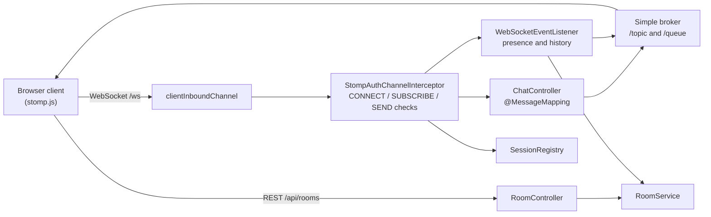

# Real-Time Chat

A real-time chat server built with **Spring Boot**, **Spring WebSocket** and the **STOMP** messaging protocol. Users pick a username, join public rooms instantly, or create password-protected private rooms. Messages, presence updates and room history are pushed live over a single WebSocket connection.


## Features

- Public rooms that anyone can enter, plus a default `General` lobby
- Private rooms protected by a BCrypt-hashed password and an invite code
- Live messaging, join/leave notifications and an online-users list per room
- Last 50 messages replayed to a user when they enter a room
- Session management: unique usernames per live connection, per-session subscription tracking, automatic cleanup on disconnect
- Server-side authorization of every STOMP `SUBSCRIBE` and `SEND` frame
- Dependency-light browser client (plain HTML, CSS, JavaScript and `@stomp/stompjs`)

## Tech stack

| Layer | Technology |
| --- | --- |
| Language | Java 17 |
| Framework | Spring Boot 3.5 (Web, WebSocket, Validation) |
| Messaging | STOMP over WebSocket with the Spring simple in-memory broker |
| Security | `spring-security-crypto` (BCrypt) for room passwords |
| Frontend | Vanilla JS, `@stomp/stompjs` from a CDN |
| Build and CI | Maven, GitHub Actions, Docker |

## Architecture



### STOMP destinations

| Direction | Destination | Purpose |
| --- | --- | --- |
| Client to server | `/app/chat/{roomId}` | Send a message to a room |
| Server to clients | `/topic/room.{roomId}` | Chat messages and JOIN/LEAVE events |
| Server to clients | `/topic/room.{roomId}.users` | Updated online-user list |
| Server to clients | `/topic/rooms` | A new public room was created |
| Server to one client | `/user/queue/history` | Room snapshot (recent messages and users) on entry |

### REST API

| Method | Path | Body | Description |
| --- | --- | --- | --- |
| `GET` | `/api/rooms` | | List public rooms |
| `POST` | `/api/rooms` | `{name, type, password, username}` | Create a `PUBLIC` or `PRIVATE` room |
| `POST` | `/api/rooms/{id}/join` | `{username, password}` | Join a room (password required for private rooms) |

A private room's `id` doubles as its invite code. Share the code and password with whoever should be allowed in.

### How a session works

1. The client opens a WebSocket to `/ws` and sends a STOMP `CONNECT` frame with a `username` header.
2. `StompAuthChannelInterceptor` validates the name, registers it in `SessionRegistry` and rejects duplicates.
3. Before every `SUBSCRIBE`, the interceptor checks that the room exists and the user may access it. Before every `SEND`, it checks that the user is actually inside the room.
4. `WebSocketEventListener` reacts to subscribe, unsubscribe and disconnect events: it updates presence, broadcasts JOIN/LEAVE notices and sends the history snapshot.
5. On disconnect, the session, its subscriptions, its presence and its private-room memberships are all cleaned up.

The sender of a message is always taken from the server-side session, never from the payload, so clients cannot impersonate each other.

## Getting started

### Prerequisites

- JDK 17 or newer
- Maven 3.9 or newer

### Run locally

```bash
git clone https://github.com/Shubham-Jha-afk/realtime-chat.git
cd realtime-chat
mvn spring-boot:run
```

Open `http://localhost:8080` in two different browser windows, choose different usernames and start chatting.

### Run the tests

```bash
mvn test
```

### Run with Docker

```bash
docker build -t realtime-chat .
docker run -p 8080:8080 realtime-chat
```

### Configuration

| Property | Default | Description |
| --- | --- | --- |
| `server.port` | `8080` | HTTP and WebSocket port |
| `chat.allowed-origins` | `*` | Comma-separated allowed WebSocket origins. Restrict this in production |

## Project structure

```
src/main/java/com/chatapp
├── ChatApplication.java
├── config        WebSocket and broker setup, STOMP auth interceptor, destination helpers
├── controller    ChatController (STOMP) and RoomController (REST)
├── dto           Request payloads with validation
├── listener      Session lifecycle events: presence, history, cleanup
├── model         Room, ChatMessage and view records
└── service       RoomService (rooms, access, history) and SessionRegistry (live sessions)
src/main/resources/static   Browser client
src/test                    Unit tests
```

## Design notes and limitations

- **In-memory state.** Rooms, history and sessions live in memory and reset on restart. This keeps the project focused on WebSocket and STOMP concepts.
- **Simple broker.** The built-in broker works for a single instance. Scaling horizontally needs an external relay such as RabbitMQ or ActiveMQ via `enableStompBrokerRelay`.
- **Lightweight identity.** Usernames are claimed per connection with no passwords or tokens. A production system should authenticate users, for example with Spring Security and JWT, and attach the identity as the STOMP `Principal`.

## Roadmap

- [ ] Persist rooms and messages with Spring Data JPA and PostgreSQL
- [ ] Authentication with Spring Security and JWT
- [ ] RabbitMQ STOMP broker relay for multi-instance deployments
- [ ] Typing indicators and direct messages through `/user/queue`
- [ ] WebSocket integration tests with `WebSocketStompClient`

## License

Released under the [MIT License](LICENSE).
